# Hi, I'm Roberto 👋

Computer Science undergrad at **Boise State University**. I build machine-learning models and data pipelines for **weather, terrain and wildfire** problems. Most of them start with a question I had while paragliding.

## Projects

**[Pre-task Analyzer](https://github.com/RobertojonesFAI/Pre-task-analyzer)** · Python, scikit-learn, ERA5
Helps paragliding competition committees set tasks: given a task, the forecast and the pilots entered, it predicts the share of pilots in goal, the winner's time and the likely route over the thermals. Built on 848 competitions, 3,114 tasks and 152,930 flights; it predicts the winner's time to within 17 minutes on competitions it never saw.

**[wind_surrogator](https://github.com/RobertojonesFAI/wind_surrogator)** · Python, PyTorch, OpenFOAM, Slurm
A U-Net trained on 1,217 OpenFOAM simulations over Idaho terrain. It reproduces CFD wind fields (speed-up, rotors, wind shadow, vertical wind) in about a minute per wind direction for a 133 × 138 km region, instead of hours of CFD.

**[ParaglidingMeteograms](https://github.com/RobertojonesFAI/ParaglidingMeteograms)** · TypeScript, Astro, GitHub Actions, Cloudflare
Automated soaring forecasts for paragliding launches in Boise, Idaho and Valle de Bravo, Mexico. NOAA, ECCC and ECMWF models are sampled every 15 minutes into hour-by-hour meteograms, Skew-T soundings and slope-sunlight maps.

**[Post-Fire Vegetation Recovery](https://github.com/RobertojonesFAI/Post_Wildfire_Vegetation)** · PyTorch, Prithvi-EO-2.0, Earth Engine
CS 497 Computer Vision team project: fine-tuning a geospatial foundation model on HLS satellite time series to track and forecast vegetation recovery in burn scars across the western US.

**[Afterburn Watch](https://github.com/RobertojonesFAI/AfterburnWatch)** · Python, Sentinel-2, Landsat, USGS pfdf
R-CON 2026 hackathon, Wildfire Resilience challenge. A feedback loop that checks USGS post-fire debris-flow predictions against satellite imagery of what actually happened after a storm. I led data integration.

## Tools

Python · PyTorch · scikit-learn · TypeScript · Java · Google Earth Engine · OpenFOAM · GitHub Actions · Cloudflare Workers · Slurm / HPC · Git

## GitHub activity

  <picture>
    <source media="(prefers-color-scheme: dark)" srcset="https://raw.githubusercontent.com/RobertojonesFAI/RobertojonesFAI/main/profile/stats-dark.svg">
    
  </picture>
  <picture>
    <source media="(prefers-color-scheme: dark)" srcset="https://raw.githubusercontent.com/RobertojonesFAI/RobertojonesFAI/main/profile/top-langs-dark.svg">
    
  </picture>

<picture>
  <source media="(prefers-color-scheme: dark)" srcset="https://raw.githubusercontent.com/RobertojonesFAI/RobertojonesFAI/main/profile/snake-dark.svg">
  
</picture>

## About me

- Paraglider pilot. I like turning flight logs and weather models into tools other pilots can use.
- Interested in ML for the atmosphere and the Earth's surface: thermals, terrain wind, remote sensing.
- I speak Spanish and English.

📫 robertojones@u.boisestate.edu
